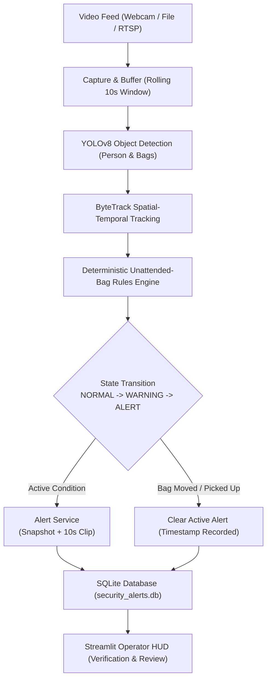

# RailGuard Vision — Implementation Plan

## 1. System Mission & Operational Architecture

**RailGuard Vision** is an AI-assisted optical surveillance and early-warning operator decision-support prototype engineered for Indian Railways station premises (platforms, waiting halls, concourses, and ticket counters). 

### Operational Mandate & Strict Boundaries
- **Early-Warning & Triage Only**: Optical cameras observe external geometric and temporal attributes. Optical sensors cannot determine internal contents, chemical composition, explosive hazards, or contraband.
- **Human-in-the-Loop Protocol**: Every alert generated is strictly marked **FOR HUMAN REVIEW ONLY**. No automated security intervention, evacuation, or ticketing enforcement is ever triggered.
- **Privacy & Ethical Safeguards**: The system does not perform facial recognition, biometric identity inference, or demographic classification. Track IDs represent ephemeral video bounding box trajectories, not human identities. Loitering is treated as an inherently noisy contextual cue, not proof of malicious intent.



---

## 2. Project Structure

```text
RailGuard_Vision/
├── IMPLEMENTATION_PLAN.md      # Architecture, state machine, testing roadmap
├── README.md                   # Operator guide, safety disclaimers, quick start
├── LIMITATIONS.md              # Technical constraints, optical bounds, physics limits
├── requirements.txt            # Constrained dependencies
├── run.bat                     # Windows one-command launcher
├── run.sh                      # Unix/macOS one-command launcher
├── evaluate.py                 # Ground truth vs alert evaluation harness
├── configs/
│   └── config.yaml             # External thresholds, model weights, capture configs
├── src/
│   ├── __init__.py
│   ├── config.py               # Strongly typed dataclass configuration loader
│   ├── capture.py              # Frame grabber with ring buffer for pre-alert context
│   ├── detector.py             # YOLOv8 inference wrapper with category filtering
│   ├── tracker.py              # ByteTrack trajectory & state tracking
│   ├── rules.py                # Deterministic spatial-temporal state machine
│   ├── alerts.py               # Snapshot extraction & rolling clip synthesis
│   ├── db.py                   # SQLite persistence, review status & metrics
│   └── pipeline.py             # Integrated video processing pipeline
├── app/
│   └── dashboard.py            # Streamlit interactive operator monitoring console
├── tests/
│   ├── __init__.py
│   ├── test_config.py          # Config validation & defaults testing
│   ├── test_rules.py           # Synthetic trajectory rules & state transitions
│   ├── test_tracker.py         # Track history, dropout & displacement testing
│   ├── test_alerts.py          # Ring buffer clip generation & duplicate suppression
│   └── test_db.py              # SQLite CRUD, reviews & false-alarm rate testing
└── data/
    ├── videos/                 # Sample evaluation footage
    ├── ground_truth/           # Evaluation CSV scenario annotations
    ├── alerts/                 # Saved JPEG snapshot evidence
    └── clips/                  # Saved MP4 video evidence clips
```

---

## 3. Implementation Phases

### Phase 1: Video Capture, Detection & Tracking
- **Config Management (`src/config.py`)**: Load YAML with sensible fallback defaults, path resolution, and type validation.
- **Video Capture & Rolling Ring Buffer (`src/capture.py`)**: Support webcam (index 0), video files, and RTSP streams. Maintain a thread-safe circular deque of `(timestamp, frame)` tuples to supply 10 seconds of historical context when an alert triggers.
- **Detector Wrapper (`src/detector.py`)**: Filter COCO classes for `person (0)`, `backpack (24)`, `handbag (26)`, `suitcase (28)`. Expose configurable confidence thresholds and input image scaling.
- **Tracker Integration (`src/tracker.py`)**: Maintain tracking state, centroid histories, displacement calculation over sliding temporal windows, and association distance matrices.

### Phase 2: Unattended-Bag Rules Engine
- **Heuristic Owner Association**: On first appearance of a bag, calculate Euclidean distance to all detected persons. If the nearest person is within `proximity_pixels`, establish an association. Maintain stability across frames.
- **Stationarity Validation**: Verify if centroid displacement over `stationary_window_seconds` remains within `stationary_pixels`.
- **Three-Tier State Machine**:
  - `NORMAL`: Bag moving with passenger or stationary with passenger nearby.
  - `WARNING`: Stationary bag whose associated owner or nearest bystander has moved beyond `proximity_pixels` for $> \text{warning\_seconds}$.
  - `ALERT`: Condition sustained for $> \text{unattended\_seconds}$.
- **Edge-Case Mitigations**:
  - Grace period for detector dropouts (`track_drop_grace_seconds = 2.5s`).
  - Owner return tolerance (`owner_left_grace_seconds = 8.0s`).
  - Bag retrieval or movement immediately transitions state back to `NORMAL` and records `cleared_timestamp`.
  - Non-associated bags (detected without anyone nearby) enter a conservative unassociated evaluation mode.

### Phase 3: Evidence Capture & SQLite Persistence
- **Snapshot Generator**: Extract clean and annotated frames on initial alert transition.
- **Clip Synthesizer**: Stitch rolling pre-alert frames with post-alert frames into an MP4 clip using OpenCV `VideoWriter`.
- **Database Engine (`src/db.py`)**: Thread-safe SQLite schema storing alert IDs, timestamps, camera IDs, track IDs, durations, file paths, and review verdicts (`unreviewed`, `verified`, `false_alarm`).
- **Duplicate Prevention**: Hash/latch active track alerts so duplicate records are not spawned on every frame.

### Phase 4: Streamlit Operator Dashboard
- Live feed rendering with toggleable bounding boxes, centroid traces, and proximity vectors.
- Prominent mandatory warning banners: **FOR HUMAN REVIEW ONLY**.
- Real-time Alert Drawer with snapshot preview, clip playback, and review actions.
- Running false-alarm calculation:
  $$\text{False Alarm Rate} = \frac{\text{False Alarm Reviews}}{\text{Total Reviewed Alerts}}$$
- Graceful camera release mechanism.

### Phase 5: Evaluation Framework
- `evaluate.py`: CLI script taking `--ground-truth ground_truth.csv` and comparing against `security_alerts.db`.
- Calculates Detection Delay, Precision, Recall, False Alarms per hour, TP, FP, FN.

### Phase 6: Automated Unit Test Suite
- Comprehensive synthetic test suite across configs, state machines, tracker logic, database operations, and alert pipelines.

---

## 4. Key Assumptions & Constraints

1. **Camera Position**: Fixed overhead or elevated oblique CCTV view typical in railway station platforms.
2. **Perspective Invariance**: Distance measured in pixels. Camera perspective scale variations are handled via configurable pixel proximity thresholds.
3. **CPU Execution**: Defaults optimized for CPU execution on standard laptops (input resizing to 640px, frame skipping option).
4. **Lighting & Crowd Density**: Dense crowd stampedes or heavy occlusions can temporarily drop tracks. The system applies temporal grace windows rather than instantaneous state flips.

---

## 5. Acceptance Criteria

| ID | Criterion | Verification Method |
|---|---|---|
| AC-1 | Parse configuration cleanly from YAML with override safety | `test_config.py` |
| AC-2 | Track state transitions NORMAL -> WARNING -> ALERT | `test_rules.py` |
| AC-3 | Suppress alert when owner remains near bag | `test_rules.py` |
| AC-4 | Reset/clear alert when bag moves or is retrieved | `test_rules.py` |
| AC-5 | Tolerate brief detection dropouts without false alert spikes | `test_rules.py` |
| AC-6 | Prevent duplicate database entries for active alert sessions | `test_alerts.py` & `test_db.py` |
| AC-7 | Persist snapshots, video clips, and database records | `test_db.py` & `test_alerts.py` |
| AC-8 | Review actions update database and compute false-alarm rate | `test_db.py` |
| AC-9 | All pytest unit tests pass with zero errors | `pytest -q` |
| AC-10 | Prominently display mandatory safety & review disclaimers in UI and docs | Code inspection & UI review |

---

## 6. Known Risks & Technical Limitations

- **Optical Horizon**: Visible light cannot detect chemical traces, concealed weapons, or sealed liquids.
- **Camera Motion**: Mobile pan-tilt-zoom or handheld cameras will cause stationary objects to appear moving unless optical flow image stabilization is applied.
- **Track ID Switches**: In extremely crowded platforms, ByteTrack may switch IDs between closely passing pedestrians.
- **Unassociated Baggage**: Left luggage introduced without a detected owner is handled via proximity to nearest passersby, but lacks historical owner baseline.
